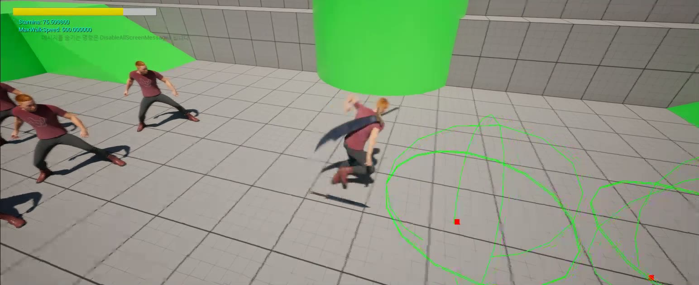

# RyuSouls

**Unreal EngineとC++で開発中の、ソウルライクな三人称視点アクションゲームのポートフォリオです。**

ダークソウルシリーズに着想を得て、スタミナによる行動制限、アニメーションと連動する近接戦闘、敵へのロックオンなど、戦闘の基本システムを実装しています。

現在は、**プレイヤー操作と戦闘の基盤を構築している段階**です。このリポジトリでは、各機能の動作に加え、入力・アニメーション・当たり判定・状態管理がどのようにつながっているかをご確認いただけます。

## プレイ動画

**[プレイ動画を見る / ダウンロード](docs/media/RyuSouls-gameplay.mp4)** · 約26秒 · MP4 · 8.86 MB

開発用マップで撮影した、現在の実装を紹介する動画です。画面には開発中のUIとデバッグ表示が含まれています。

## ソースコードの見どころ

以下の順にご覧いただくと、**攻撃入力 → アニメーション → 命中判定 → 敵の被弾・死亡処理**という戦闘の流れを確認できます。

| 順番 | 確認できる内容 | 主なソースコード |
| --- | --- | --- |
| 1 | 攻撃入力、実行条件、コンボの接続 | [RsCharacter.cpp](Source/RyuSouls/Private/Characters/RsCharacter.cpp) |
| 2 | 攻撃アニメーションの判定区間と命中判定 | [AnimNotifyState_RsWeaponHit.cpp](Source/RyuSouls/Private/Animations/AnimNotifyState_RsWeaponHit.cpp), [RsWeaponCollisionComponent.cpp](Source/RyuSouls/Private/Component/RsWeaponCollisionComponent.cpp) |
| 3 | 攻撃種別ごとのダメージと敵の被弾・死亡処理 | [RsWeapon.cpp](Source/RyuSouls/Private/Equipments/RsWeapon.cpp), [RsEnemy.cpp](Source/RyuSouls/Private/Characters/RsEnemy.cpp) |
| 4 | ロックオン候補の検索、対象の切り替え、カメラの追従 | [RsTargetingComponent.cpp](Source/RyuSouls/Private/Component/RsTargetingComponent.cpp) |

## 開発環境

- **Unreal Engine 5.8** — [プロジェクトファイル](RyuSouls.uproject)で指定しているバージョン
- **C++ / Blueprint / Animation Blueprint**
- **Enhanced Input / Gameplay Tags**
- **Animation Montage / AnimNotify / DataAsset / UMG**

## 主な実装内容

### 1. 攻撃とコンボ

通常攻撃・強攻撃・ダッシュ攻撃・特殊攻撃を区別しています。武器の装備有無・抜刀状態・行動状態・スタミナ残量を確認し、攻撃を開始できるか判断します。

コンボは、アニメーションに設定した入力受付区間を基準につなぎます。`AnimNotifyState`が区間の開始と終了を通知し、キャラクターは区間内の入力を保持して、区間終了時に次の攻撃を実行します。攻撃終了後も設定した時間内は追加入力を受け付け、期限を過ぎるとコンボをリセットします。

- **注目する関数:** `CanPerformAttack`, `ExecuteComboAttack`, `DoAttack`, `DisableComboWindow`, `AttackFinished`
- **関連ソース:** [RsCharacter.cpp](Source/RyuSouls/Private/Characters/RsCharacter.cpp), [AnimNotifyState_RsComboWindow.cpp](Source/RyuSouls/Private/Animations/AnimNotifyState_RsComboWindow.cpp), [AnimNotify_RsAttackFinished.cpp](Source/RyuSouls/Private/Animations/AnimNotify_RsAttackFinished.cpp)

### 2. アニメーションと連動する命中判定

攻撃アニメーション内の指定区間でのみ、武器の命中判定を有効にします。

判定が有効な間、武器の2つのソケット間で`SphereTraceMultiForObjects`を実行します。同じ判定区間ですでに命中した対象を記録してダメージの重複を防ぎ、命中結果をデリゲートで武器へ通知します。

武器は攻撃種別に応じたダメージを計算し、`ApplyPointDamage`で対象に適用します。衝突判定コンポーネントが対象の検出を、武器がダメージの計算と適用を担当します。

- **注目する関数:** `TurnOnCollision`, `CollisionTrace`, `GetAttackDamage`, `OnHitActor`
- **関連ソース:** [AnimNotifyState_RsWeaponHit.cpp](Source/RyuSouls/Private/Animations/AnimNotifyState_RsWeaponHit.cpp), [RsWeaponCollisionComponent.cpp](Source/RyuSouls/Private/Component/RsWeaponCollisionComponent.cpp), [RsWeapon.cpp](Source/RyuSouls/Private/Equipments/RsWeapon.cpp)

### 3. 武器データと装備の交換

攻撃・抜刀・納刀のアニメーションを、`GameplayTag`と`DataAsset`で対応付けています。キャラクターが行動タグとコンボ段数を渡し、武器が参照するデータから使用するMontageを取得します。攻撃ごとのスタミナ消費量とダメージ倍率も武器側で管理します。

フィールド上の武器を拾うと、装備Actorを生成してキャラクターに取り付けます。すでに武器を装備している場合は、以前の武器をPickupとしてフィールドに戻します。抜刀・納刀では、`AnimNotify`の通知時点で武器の取り付け先ソケットを変更します。

- **注目する関数:** `GetMontageForTag`, `SetWeapon`, `Interact`, `EquipItem`
- **関連ソース:** [RsMontageActionData.h](Source/RyuSouls/Public/Data/RsMontageActionData.h), [RsCombatComponent.cpp](Source/RyuSouls/Private/Component/RsCombatComponent.cpp), [RsPickupItem.cpp](Source/RyuSouls/Private/Items/RsPickupItem.cpp), [AnimNotify_RsEquipWeapon.cpp](Source/RyuSouls/Private/Animations/AnimNotify_RsEquipWeapon.cpp)

### 4. スタミナと行動状態の管理

ダッシュ・ローリング・攻撃でスタミナを消費し、一定時間が経過した後、タイマーでスタミナを回復します。最大値に達すると回復タイマーを停止します。

スタミナの変更をデリゲートでHUDへ通知し、HUDはその通知を受けてゲージを更新します。

攻撃・ローリング・装備切り替えなどの行動状態を`GameplayTag`で管理し、行動条件の確認と移動入力の制限に使用します。

- **注目する関数:** `DecreaseStamina`, `ToggleStaminaRegeneration`, `RegenerateStaminaHandler`, `ToggleMovementInput`
- **関連ソース:** [RsAttributeComponent.cpp](Source/RyuSouls/Private/Component/RsAttributeComponent.cpp), [RsStateComponent.cpp](Source/RyuSouls/Private/Component/RsStateComponent.cpp), [RsPlayerHUDWidget.cpp](Source/RyuSouls/Private/UI/RsPlayerHUDWidget.cpp)

### 5. 敵へのロックオンとカメラ

専用のコリジョンチャンネルで周囲の候補を検索し、`IRsTargeting`インターフェースでロックオン可能かを確認します。

カメラの向きを基準に対象を選択し、左右の対象への切り替えを処理します。ロックオン中は、対象に向くようカメラの回転を補間するとともに、キャラクターの旋回方式を切り替えます。対象が死亡した場合や距離の上限を超えた場合は、ロックオンを解除します。

対象側のインターフェースは、ロックオンマーカーの表示・非表示にも使用します。

- **注目する関数:** `FindTargets`, `FindClosestTarget`, `SwitchingLockedOnActor`, `FaceLockOnActor`
- **関連ソース:** [RsTargetingComponent.cpp](Source/RyuSouls/Private/Component/RsTargetingComponent.cpp), [RsTargeting.h](Source/RyuSouls/Public/Interface/RsTargeting.h)

### 6. 敵の被弾リアクションと死亡処理

敵は受け取ったダメージで体力を更新し、命中位置で効果音とパーティクルを再生します。

敵の向きと攻撃者の位置関係から被弾方向を前後左右に分類し、対応する被弾Montageを選択します。体力が0になるとカプセルの衝突を無効にし、メッシュをRagdollの物理シミュレーションへ切り替えます。

- **注目する関数:** `TakeDamage`, `GetHitReactAnimation`, `ImpactEffect`, `OnDeath`
- **関連ソース:** [RsEnemy.cpp](Source/RyuSouls/Private/Characters/RsEnemy.cpp)

## コードとエディタ設定の場所

| パス | 内容 |
| --- | --- |
| [Source/RyuSouls/Public](Source/RyuSouls/Public) | クラス宣言、インターフェース、データ構造 |
| [Source/RyuSouls/Private](Source/RyuSouls/Private) | ゲームプレイロジックの実装 |
| [Content/_Game/Blueprints](Content/_Game/Blueprints) | キャラクター・敵・武器のBlueprintとAnimation Blueprint |
| [Content/_Game/Data](Content/_Game/Data) | 行動アニメーションを設定するDataAsset |
| [Content/_Game/Input](Content/_Game/Input) | Input Actionと入力マッピング |
| [Content/_Game/UI](Content/_Game/UI) | スタミナHUDとロックオンUI |
| [Content/_Game/Maps/DevMap.umap](Content/_Game/Maps/DevMap.umap) | 開発用テストマップ |

Blueprintやアニメーションの詳細設定はUnreal Editorで確認できます。C++ソースと併せて`BP_RsCharacter`、`ABP_RsCharacter`、`DA_SwordAndShield`をご覧いただくと、コードとアセットの連携を確認できます。

## 現在の開発状況

プレイヤーの基本移動・戦闘、武器の取得・交換、スタミナ管理、敵の被弾・死亡処理、ロックオンに関するロジックを実装しています。引き続き、機能間の連携や動作・演出の調整を進めています。

完成版として提供する前の開発段階であり、体力HUDはまだ連携していません。現時点では、**プレイヤーの戦闘システムと各機能の実装構造**を中心にご覧ください。
